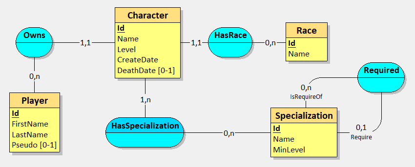

# Exercice EFCore
Réaliser une application en ASP.NET pour manipuler une base de donnée. \
Utilisation de EFCore pour : 
- Mise en place la base de donnée en code first.
- Utilisation de la base de donnée avec LinQ.

## Schema de la base de donnée

## Informations complémentaires
- Cette application est un simple CRUD (Pas de régles métiers).
- Pas de gestion de compte utilisateur.
- Le client _(aka le formateur)_ peut modifier le schema de base de donnée.